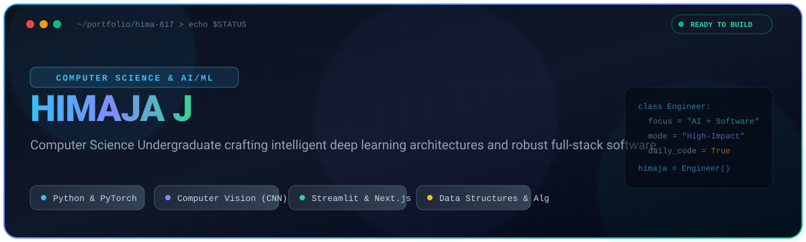
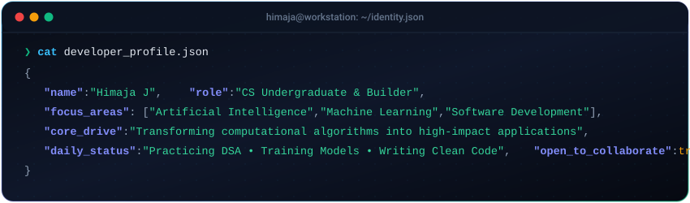

  <!-- HERO BANNER -->
  

    

  <!-- PRIMARY ANIMATED INTRODUCTION: NAME IS THE MAIN ATTRACTION -->
  

  <!-- SECONDARY ANIMATED ROTATION -->
  

    
  

  <!-- SHORT AUTHENTIC DEVELOPER BIO -->
  

    <strong>Computer Science and Engineering undergraduate passionate about building practical software and machine learning solutions.</strong> 
    Driven by curiosity, analytical problem-solving, and a commitment to continuous learning and real-world impact.
  

  <!-- STATUS PILLS -->
  

    
    &nbsp;
    
    &nbsp;
    
  

  <!-- QUICK ACTION CONNECT BUTTONS -->
  

    
    &nbsp;
    
    &nbsp;
    
  

---

### ⚡ About Me

I am a Computer Science and Engineering undergraduate who genuinely enjoys exploring the intersection of **AI/ML**, **software development**, and **data analytics**. For me, coding is all about taking interesting ideas and transforming them into practical, functional applications that solve real-world problems.

- 💡 **Building Practical Applications:** I love turning concepts into tangible software—whether it's training convolutional neural networks for medical image analysis or crafting interactive tools that streamline workflows.
- 🧩 **Strengthening Problem Solving:** I actively practice Data Structures and Algorithms to sharpen my analytical thinking, optimize logic, and write clean, maintainable code.
- 🤝 **Hackathons & Collaboration:** I enjoy participating in hackathons, working alongside fellow developers in team projects, and learning through shared problem-solving and peer review.
- 🌱 **Continuous Learning Mindset:** The tech landscape evolves every day, and I believe the best way to grow is through hands-on experimentation, steady practice, and building things that matter.

 

<!-- DEVELOPER IDENTITY TERMINAL CARD -->

  

---

### 🛠️ Tech Stack & Skills Showcase

A breakdown of programming languages, machine learning frameworks, and developer tools verified across my repositories:

#### 1. Programming Languages

  
  
  
  
  

#### 2. AI / Machine Learning & Data Science

  
  
  
  
  
  
  
  

#### 3. Web & Application Development

  
  
  
  
  
  
  

#### 4. Databases & Cloud Concepts

  
  
  
  

#### 5. Developer Tools & Platforms

  
  
  
  
  

---

### 🌐 Connect With Me

I'm always open to discussing AI/ML projects, software engineering opportunities, hackathons, or open-source collaborations. Feel free to reach out!

- 📫 **Direct Email:** [hima061627@gmail.com](mailto:hima061627@gmail.com)
- 💼 **LinkedIn Profile:** [linkedin.com/in/himaja-j-99b88b337](https://www.linkedin.com/in/himaja-j-99b88b337)
- 🐙 **GitHub Profile:** [github.com/Hima-617](https://github.com/Hima-617)

 

  
  &nbsp;&nbsp;
  
  &nbsp;&nbsp;
  

 

  

    Designed with care &bull; Personalized for <strong>Himaja J</strong> &bull; &copy; 2026
  

